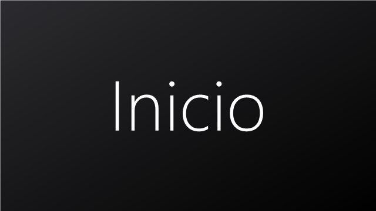
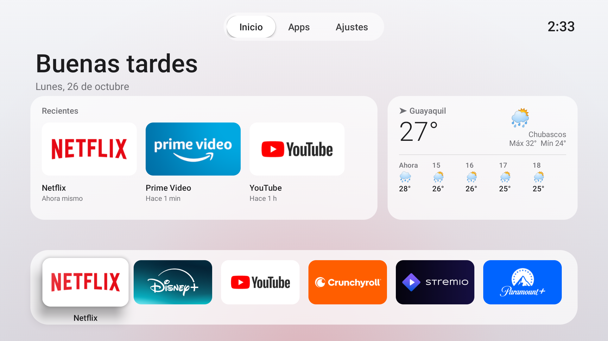
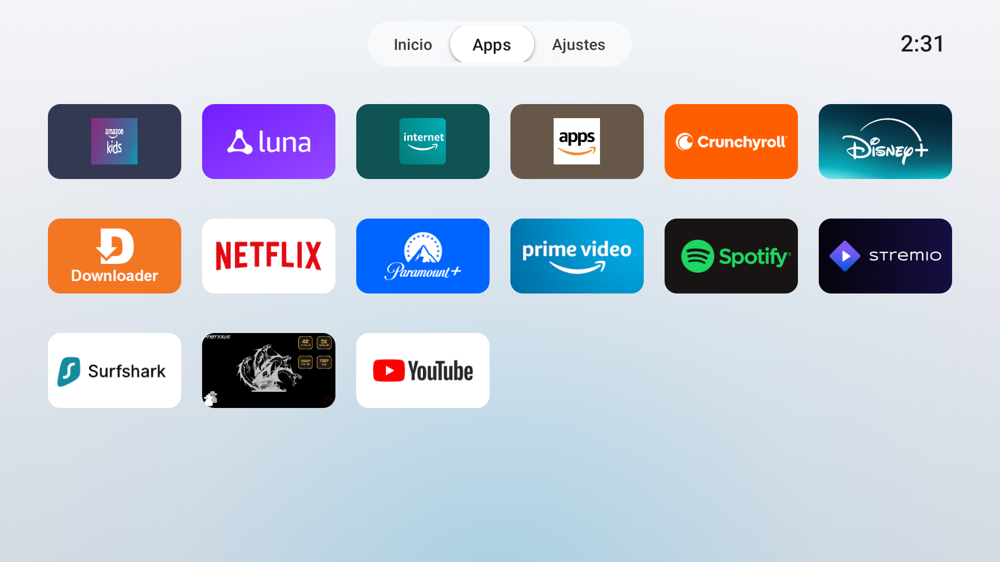
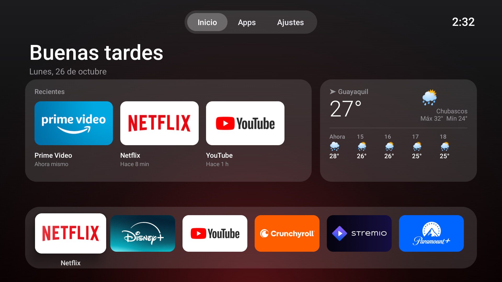

<div align="center">



# Inicio ATV

**Tu Fire TV con estilo Apple TV, sin anuncios y más rápida.**
Un launcher propio de unos 50 KB y unos scripts que limpian Fire OS por ADB, sin root.
Todo se puede deshacer con un comando.

[](LICENSE)
[](#-dispositivos-compatibles)
[](#-cómo-funciona)
[](launcher/src/com/josue/atvhome)
[](#-el-launcher)
[](https://github.com/Josuerti/firetv-inicio-atv/stargazers)



</div>

---

## ✨ Cómo funciona

| Paso | Qué pasa | Herramienta |
|:---:|---|---|
| **1** | Te conectas a la Fire TV por Wi-Fi con ADB, la herramienta oficial de Android | `adb` |
| **2** | Se guarda un respaldo de la TV y se desactivan la telemetría, la publicidad y las apps de Amazon que sobran | `tools/optimizar.ps1` |
| **3** | Se instala **Inicio ATV** y un servicio hace que el botón Inicio del mando lo abra siempre | `tools/build.ps1` + `adb install` |

> **En resumen:** la pantalla de Amazon desaparece, los menús van el doble de rápido y no se borra nada.

---

## 🚀 Inicio rápido

| Necesitas | Para qué |
|---|---|
| Fire TV Stick 4K (2.ª gen.) u otra Fire TV con Fire OS 8 | El dispositivo |
| PC con Windows 10 u 11 | Ejecutar los scripts |
| PC y TV en la misma red Wi-Fi | Conectarse por ADB |

| # | En la TV | En el PC |
|:---:|---|---|
| 1 | *Configuración → Mi Fire TV → Acerca de* → pulsa **7 veces** el nombre del dispositivo | |
| 2 | *Opciones para desarrolladores* → activa **Depuración ADB** | `winget install Google.PlatformTools` |
| 3 | Apunta la IP: *Acerca de → Red* | `tools\optimizar.ps1 -Ip 192.168.x.x` |
| 4 | Acepta **"Permitir siempre"** cuando salga el aviso | `tools\setup-sdk.ps1` y luego `tools\build.ps1` |
| 5 | | Instala y activa el launcher (ver abajo) |
| 6 | **Desactiva la Depuración ADB** al terminar | |

```powershell
adb connect 192.168.x.x:5555
adb install -r InicioATV.apk
adb shell settings put secure enabled_accessibility_services com.josue.atvhome/com.josue.atvhome.HomeService
adb shell settings put secure accessibility_enabled 1
adb shell pm grant com.josue.atvhome android.permission.ACCESS_FINE_LOCATION   # opcional: muestra el nombre del Wi-Fi
adb shell appops set com.josue.atvhome GET_USAGE_STATS allow                    # opcional: tarjeta "Recientes"
adb shell pm grant com.josue.atvhome android.permission.WRITE_SECURE_SETTINGS   # opcional: reactiva solo el botón Inicio si Fire OS lo apaga
```

<details>
<summary><b>🪟 Notas para Windows</b></summary>

- Ejecuta los scripts con `powershell -ExecutionPolicy Bypass -File tools\<script>.ps1`.
- `winget` instala ADB en `%LOCALAPPDATA%\Microsoft\WinGet\Packages\Google.PlatformTools_...`. Los scripts lo buscan ahí solos, aunque no esté en el `PATH`.
- `setup-sdk.ps1` instala Microsoft OpenJDK 17 y el Android SDK mínimo (plataforma 30 y build-tools 34), unos 2 GB. Solo hace falta para compilar.
- La primera vez, `build.ps1` crea una llave de firma en `keystore/`. **Guárdala fuera del repo**: sin ella no se puede actualizar la app sin desinstalarla antes.

</details>

---

## 🎁 Qué consigues

| | Antes (Fire OS de serie) | Después |
|---|---|---|
| Pantalla de inicio | Anuncios, vídeos que se reproducen solos, banners patrocinados | Reloj, tus apps y un fondo que toma el color de cada app |
| Animaciones | 1x | **0.5x** |
| Apps de Amazon en segundo plano | Todas activas | **18 desactivadas** |
| Reconocimiento de lo que ves (ACR) | Activado | Desactivado |
| Anuncios personalizados y datos de uso | Activados | Desactivados |
| RAM del launcher | — | ~60 MB, y libera las imágenes cuando abres otra app |

<table>
<tr>
<td width="50%"><br><i>Inicio: saludo, apps recientes, clima por horas y dock.</i></td>
<td width="50%"><br><i>Pestaña Apps: todas tus apps. La que tiene el foco crece y muestra su nombre.</i></td>
</tr>
<tr>
<td width="50%"><br><i>Tema oscuro, en Ajustes. El fondo se tiñe del color de la app con foco.</i></td>
<td width="50%" valign="middle">

**Mando**

| Botón | Acción |
|---|---|
| OK | Abrir |
| Menú ☰ / mantener OK | Opciones de la app |
| ↑ hasta arriba | Pestañas Inicio / Apps / Ajustes |
| Atrás | Volver al dock |
| Inicio | Siempre aquí |

</td>
</tr>
</table>

---

## 📺 Dispositivos compatibles

| Dispositivo | Fire OS | Estado |
|---|---|---|
| Fire TV Stick 4K (2.ª gen., AFTKM) | 8.1.8.5 | ✅ Probado |
| Otras Fire TV con Fire OS 8 | 8.x | 🟡 Debería funcionar (no probado) |
| Fire TV con Fire OS 6 o 7 | 6.x / 7.x | 🟡 Debería funcionar, aunque algunas apps de la lista no existen |
| Fire OS 5 | 5.x | ❌ No compatible (el APK pide Android 7.1 o superior) |
| Android TV / Google TV | — | ⚠️ El launcher sirve, pero la lista de limpieza es solo para Amazon |

---

## 🧹 Qué desactiva `optimizar.ps1`

Todo se hace con `pm disable-user --user 0`: **nada se borra** y se reactiva con `restaurar.ps1 -Todo`.

<details>
<summary><b>Ver las 18 apps</b></summary>

| Paquete | Qué es |
|---|---|
| `com.amazon.tv.acr` | Reconocimiento automático de contenido (analiza lo que ves) |
| `com.amazon.device.telemetry.emitter` | Envío de telemetría |
| `com.amazon.dp.logger`, `com.amazon.perfcollection`, `com.amazon.wirelessmetrics.service`, `com.amazon.neo.minerva.logcat` | Registros y métricas |
| `com.amazon.shoptv.client`, `com.amazon.shoptv.firetv.client` | Amazon Shop |
| `com.amazon.minitv.android.app` | MiniTV |
| `com.amazon.sneakpeek` | Vídeos de prueba que se reproducen solos |
| `com.amazon.gamehub` | Game Hub |
| `com.amazon.bueller.photos`, `com.amazon.bueller.music` | Amazon Photos y Music |
| `com.amazon.ods.kindleconnect` | Kindle |
| `com.amazon.tv.earlyaccess` | Programa de acceso anticipado |
| `com.amazon.smarthomemapviewapp` | Mapa de la casa inteligente |
| `com.amazon.storm.lightning.tutorial`, `com.amazon.tmm.tutorial` | Tutoriales |

</details>

<details>
<summary><b>Ajustes que cambia</b></summary>

| Ajuste | Valor |
|---|---|
| `window_animation_scale`, `transition_animation_scale`, `animator_duration_scale` | `0.5` |
| `com.amazon.tv.settings.featured_item_video_enabled` / `_volume` | `0` |
| `advertisingIdApp:interestBasedAds:value` | `0` |
| `settingsApp:appUsageData:value`, `settingsApp:deviceUsageData:value` | `0` |
| `usage_metrics_marketing_enabled` | `0` |

</details>

<details>
<summary><b>Qué NO toca, a propósito</b></summary>

- **Actualizaciones de Fire OS:** siguen funcionando.
- **Launcher de Amazon** (`com.amazon.tv.launcher`): está protegido y quitarlo puede dejar la TV sin pantalla de inicio.
- **Prime Video y Live TV:** gastan RAM, pero desactivarlos rompe partes del sistema.
- **Paquetes protegidos** (`crashmanager`, `logmanager`): Fire OS no deja desactivarlos.

</details>

---

## 🏠 El launcher

| Función | Detalle |
|---|---|
| Pestañas | **Inicio**, **Apps** y **Ajustes** arriba, como en tvOS. Al enfocar una pestaña cambia la página |
| Saludo y reloj | "Buenos días / tardes / noches", la fecha en español y la hora arriba a la derecha |
| 🕘 Recientes | Tarjeta con las 3 últimas apps que abriste y hace cuánto ("Hace 5 min"). Necesita el permiso de acceso al uso (`appops`) |
| 🌤️ Clima | Tarjeta con temperatura, estado, máxima/mínima y las próximas 4 horas de la ciudad de tu zona horaria, con [Open-Meteo](https://open-meteo.com) (sin cuenta ni ubicación). Se actualiza cada 30 minutos |
| Dock | Hasta 6 apps. Por defecto: Netflix, Disney+, YouTube, Crunchyroll, Stremio y Paramount+ |
| Apps | Todas tus apps en orden alfabético, en cuadrícula de 6 |
| Ajustes | Wi-Fi (con el nombre de la red), Ajustes de Fire TV, inicio de Amazon, **tema claro u oscuro** y apps ocultas |
| Resplandor | Saca el color de cada logo y tiñe el fondo con una transición suave |
| Limpieza | Oculta las herramientas internas de Fire OS que salen con icono genérico |
| Se repara solo | Si Fire OS apaga el servicio del botón Inicio, Inicio ATV lo vuelve a encender al abrirse (con el permiso `WRITE_SECURE_SETTINGS`) |
| Ligero | Sin Gradle ni AndroidX: cinco clases Java, unos 53 KB |

<details>
<summary><b>¿Cómo sustituye a la pantalla de Amazon si Fire OS no lo permite?</b></summary>

Fire OS 8 no deja cambiar la pantalla de inicio por defecto. `HomeService` es un **servicio de accesibilidad** que solo escucha los cambios de ventana. Cuando aparece `com.amazon.tv.launcher/.ui.HomeActivity_vNext` (al pulsar Inicio, al arrancar o después de elegir perfil), abre Inicio ATV encima.

- Solo mira el nombre de la app que está en primer plano. No lee ni guarda nada más.
- El botón *Inicio Amazon* desactiva la redirección hasta que abras otra app, para que puedas usar perfiles, Live TV, etc.
- Al pulsar Inicio puede verse **medio segundo** la pantalla de Amazon. Es normal.

</details>

<details>
<summary><b>🔨 Compilar desde el código</b></summary>

`tools/build.ps1` no usa Gradle. Hace la cadena a mano:

```
aapt2 compile/link  →  javac --release 8  →  d8 --min-api 25  →  zipalign  →  apksigner (v2 + v3)
```

Fire OS 8 rechaza los APK firmados solo con v1. `apksigner` firma con v2 y v3 por defecto.

</details>

<details>
<summary><b>🎨 Personalizar</b></summary>

| Qué | Dónde |
|---|---|
| Apps del dock por defecto | `DEFAULT_DOCK` en `HomeActivity.java` (en la TV, con el botón Menú ☰) |
| Apps que siempre se ocultan | `EXCLUDE` en `AppEntry.java` |
| Tamaño de los recuadros y columnas | `tileW`, `tileH`, `COLS` en `HomeActivity.java` |
| Icono y banner | `tools/make-art.ps1` |
| Textos | `launcher/res/values/strings.xml` |

</details>

---

## ↩️ Restaurar

```powershell
powershell -ExecutionPolicy Bypass -File tools\restaurar.ps1         # quita Inicio ATV y vuelve la pantalla de Amazon
powershell -ExecutionPolicy Bypass -File tools\restaurar.ps1 -Todo   # y además deshace toda la optimización
```

`optimizar.ps1` guarda antes un respaldo completo en `backup/<fecha>/`: lista de paquetes y todos los ajustes `global`, `secure` y `system`.

---

## 🛠️ Solución de problemas

- 🔌 **`unauthorized` al conectar:** acepta el aviso en la TV. Si no sale, pulsa Inicio para despertarla y vuelve a ejecutar `adb connect`.
- 🏠 **Vuelve a salir la pantalla de Amazon:** una actualización ha apagado el servicio. Ve a *Ajustes → Accesibilidad → Inicio ATV → Activar*. Fire OS también lo apaga si fuerzas el cierre de Inicio ATV (`am force-stop`): al actualizar, usa solo `adb install -r`.
- 🌤️ **No sale el clima:** necesita internet. Si no hay red, se reintenta cada minuto.
- 🕘 **No sale la tarjeta Recientes:** falta el permiso. Ejecuta `adb shell appops set com.josue.atvhome GET_USAGE_STATS allow`.
- 📶 **El botón dice "Wi-Fi" sin el nombre de la red:** falta el permiso de ubicación. Ejecuta el `pm grant` del inicio rápido.
- 🖤 **`adb screencap` sale negro:** la TV está en reposo. Ejecuta `adb shell input keyevent KEYCODE_WAKEUP`.
- 🔁 **Después de actualizar Fire OS vuelve alguna app de Amazon:** vuelve a ejecutar `optimizar.ps1`. Se puede repetir sin problema.
- ❌ **`INSTALL_FAILED_UPDATE_INCOMPATIBLE`:** compilaste con otra llave. Usa la `keystore/` original o desinstala la app antes.
- ⌨️ **`javac: invalid flag`:** usa el `build.ps1` del repo. PowerShell parte algunos argumentos de `javac` si no van entre comillas.

---

## ❓ Preguntas frecuentes

<details><summary><b>¿Necesito root?</b></summary>

No. Todo se hace con ADB y con los permisos que Fire OS da a la depuración.
</details>

<details><summary><b>¿Pierdo la garantía o las actualizaciones?</b></summary>

No se modifica el sistema ni se desbloquea nada. Las actualizaciones de Fire OS siguen llegando.
</details>

<details><summary><b>¿Es un launcher de verdad o una app?</b></summary>

Técnicamente es una app que se pone encima de la pantalla de Amazon cada vez que esta aparece. Fire OS no permite otra cosa sin root. En la práctica, el botón Inicio siempre te lleva a Inicio ATV.
</details>

<details><summary><b>¿Gasta más memoria tener dos launchers?</b></summary>

El de Amazon sigue cargado, como siempre. Inicio ATV usa unos 60 MB y suelta las imágenes cuando abres otra app. A cambio, te ahorras los vídeos y anuncios de la pantalla de Amazon.
</details>

<details><summary><b>¿Y la depuración ADB? ¿Es seguro dejarla activada?</b></summary>

No. Mientras está activada, cualquiera en tu red puede intentar conectarse (aunque tendrías que aceptarlo en la TV). **Desactívala al terminar.**
</details>

<details><summary><b>¿Por qué no hay "Seguir viendo" como en Apple TV?</b></summary>

Lo probamos. La lista del sistema (`content://android.media.tv/watch_next_program`) existe en Fire OS 8, pero **está vacía**: Netflix, Disney+, YouTube y las demás apps de Fire TV no publican ahí lo que estás viendo. La fila **Recientes** es lo más parecido que se puede hacer.
</details>

<details><summary><b>¿El clima es de mi ciudad?</b></summary>

Usa la ciudad principal de tu zona horaria (`America/Guayaquil` → Guayaquil, `America/Bogota` → Bogotá, etc.). Para otra ciudad, edita `cityFor` en `Weather.java`.
</details>

<details><summary><b>¿Puedo cambiar las apps del dock?</b></summary>

Sí. Pulsa Menú ☰ sobre cualquier app: *Añadir al dock*, *Quitar del dock*, *Mover a la izquierda / derecha*.
</details>

---

## 🙏 Créditos

- Inspirado en [CleanYourTV](https://github.com/Gathin23/cleanyourtv) de Gathin23, que limpia Android TV y Google TV. Este proyecto lleva la idea a Fire TV, donde aquel no funciona.
- Las ideas del clima con Open-Meteo y de la fila de apps recientes vienen de [Luma TV](https://github.com/0xProbabillity/luma-tv) de 0xProbabillity (MIT).
- Hecho con [Claude Code](https://claude.com/claude-code).

## ⚖️ Aviso legal

- Proyecto independiente, sin relación con Amazon, Apple ni ninguna de las apps que aparecen. Fire TV, Fire OS, Apple TV, Netflix, Disney+, YouTube, Crunchyroll y Stremio son marcas de sus dueños.
- No incluye, enlaza ni facilita contenido protegido por derechos de autor.
- Lo usas bajo tu responsabilidad. Haz siempre el respaldo y ten a mano `restaurar.ps1`.

## 📄 Licencia

[MIT](LICENSE) © 2026 Josuerti

---
